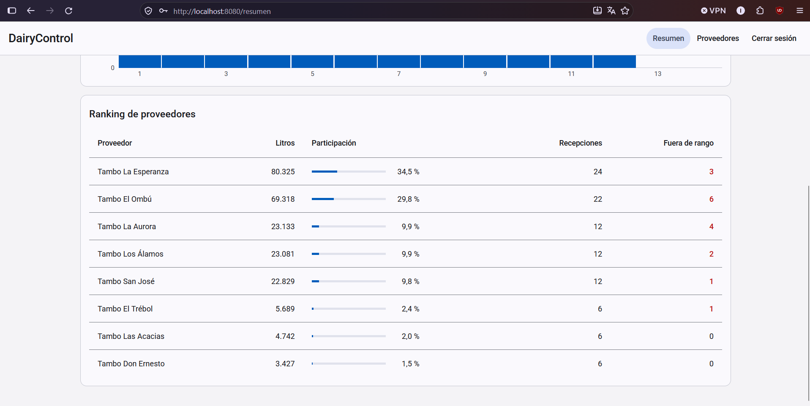
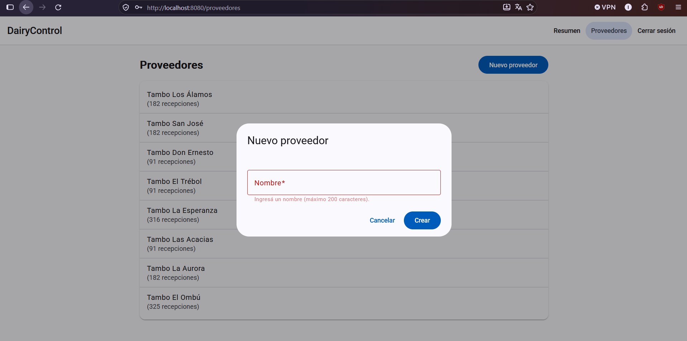
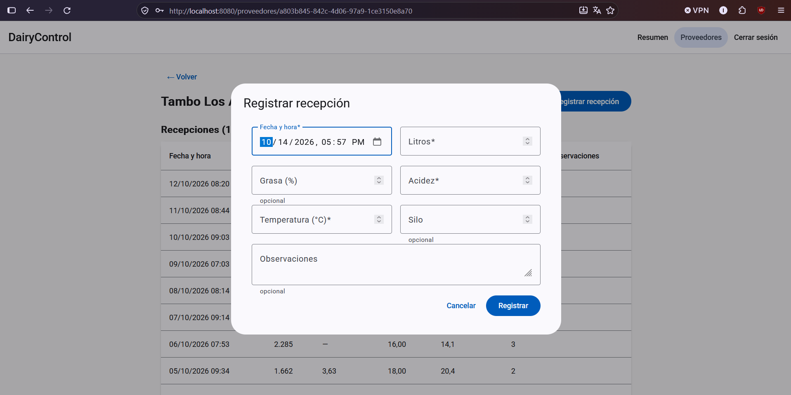
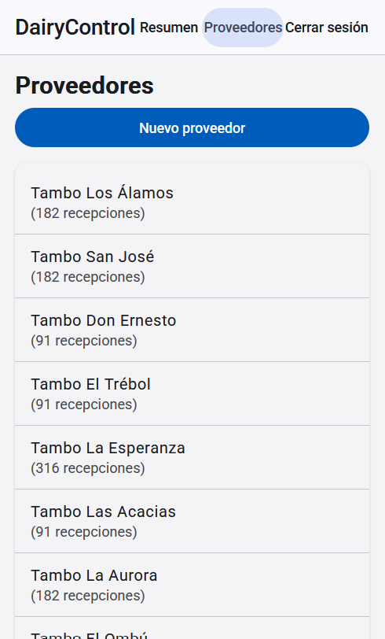
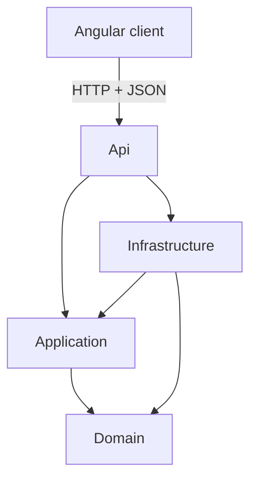
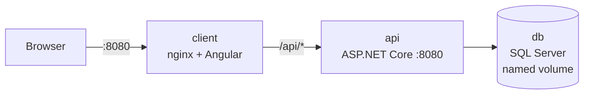
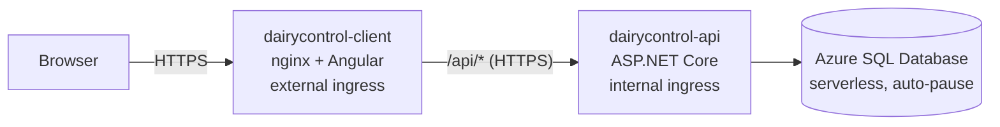

# DairyControl

Milk reception and quality-control system for a small dairy plant: a **.NET 10** REST API built with **Clean Architecture** and **Domain-Driven Design**, an **Angular** client, and a containerized stack with **Docker Compose**.

> **Status:** backend complete (REST API, JWT authentication, error handling, unit tests). Angular client complete for the reception module: login, protected pages, proveedores, recepción registration, reception dashboard with configurable quality limits, Angular Material UI. Full stack runs with Docker Compose; CI builds and tests both backend and client. Demo data is seeded on startup. **Live on Azure Container Apps**, deployed automatically on every merge to `main`.

## Live demo

**https://dairycontrol-client.graywave-771c6a95.brazilsouth.azurecontainerapps.io**

Log in as `admin` with the password `demodemo123`. These credentials exist only for the demo environment, and all data is synthetic.

The demo scales to zero when nobody is using it and its database pauses, so the first request after a quiet period can take up to a minute; the app shows a message while the server wakes up.

## What it does

DairyControl registers milk suppliers (_proveedores_) and every delivery received at the plant (_recepción_): volume in liters, temperature, acidity, optional fat content, destination silo, timestamp and free-text notes.

On top of the records, a **Resumen** dashboard answers the plant's key question for any period: how much milk came in, compared with the previous period, from which suppliers, and how many deliveries were out of range. Quality limits (acidity, temperature and added water) are configurable per plant from the app.

The domain model is based on real reception logs from a dairy plant. All data in this repository is synthetic.

## Screenshots

**Resumen**: liters, quality, liters per day and supplier ranking for any period, compared with the previous period.




| Proveedores                                           | Recepciones                                       |
| ----------------------------------------------------- | ------------------------------------------------- |
|  |  |

| Register recepción                                                      | Mobile                                      |
| ----------------------------------------------------------------------- | ------------------------------------------- |
|  |  |

## Quick start (Docker)

The fastest way to run everything: SQL Server, the API and the client. Only Docker is required.

```bash
cp .env.example .env        # PowerShell: Copy-Item .env.example .env
# edit .env and set your own values
docker compose up --build
```

Open `http://localhost:8080` and log in as `admin` with the `ADMIN_PASSWORD` from `.env`. Migrations are applied automatically when the API starts. On a fresh database the API also seeds about 6 months of demo data (8 proveedores, ~1,400 recepciones), so the app looks like a plant in operation.

- Stop: `docker compose down`
- Stop and delete the database: `docker compose down -v`

## Tech stack

**Backend**

- .NET 10, ASP.NET Core Web API
- Entity Framework Core 10 + SQL Server
- JWT bearer authentication
- Swagger / OpenAPI (Swashbuckle, development only)
- xUnit + Moq

**Client**

- Angular (standalone components, signals, new control flow)
- Angular Material 3, `es-AR` locale for numbers and dates
- Reactive forms with validation mirroring the domain rules
- JWT handling with an HTTP interceptor and route guards

**Infrastructure**

- Docker (multi-stage images, non-root containers) and Docker Compose
- nginx serving the client and reverse-proxying the API
- GitHub Actions: backend and client build and tests on every push and pull request; deployment on every merge to `main`
- Azure Container Apps (consumption plan, scale to zero) and Azure SQL Database (serverless, free offer)
- GitHub Container Registry for images; Azure login from GitHub Actions with OIDC

## Architecture

Four backend layers, with dependencies pointing inward. Domain has no dependencies on any other project. The client talks to the API over HTTP and never touches the database.



| Layer              | Responsibility                                                                                                      |
| ------------------ | ------------------------------------------------------------------------------------------------------------------- |
| **Domain**         | Entities, value objects, business rules, repository interfaces. No framework dependencies.                          |
| **Application**    | Use-case orchestration (`ProveedorAppService`, `AuthService`), DTOs, settings. Depends only on Domain abstractions. |
| **Infrastructure** | EF Core `DbContext`, Fluent API mappings, migrations, repository implementations.                                   |
| **Api**            | Controllers, middleware, authentication, dependency injection and pipeline setup (composition root).                |
| **Client**         | Angular pages, routing and services that consume the API.                                                           |

### Runtime (Docker Compose)



Only the client publishes a port. The API and the database are reachable only inside the Compose network, by service name.

### Runtime (Azure)



The same shape as Compose: only the client is public. The API's ingress is internal to the Container Apps environment, and the nginx upstream comes from the `API_UPSTREAM` environment variable. Both apps scale from 0 to 1 replica.

## Domain model

- **`Proveedor`** (aggregate root): a supplier. It holds no recepciones.
- **`RecepcionLeche`** (aggregate root): a single delivery, created with `RecepcionLeche.Registrar(proveedorId, ...)` and linked to its `Proveedor` by id.
- **`ParametrosCalidad`** (value object, `record`): quality and volume measurements, including the optional added-water percentage (0–100), validated at creation through a factory method.
- **`RecepcionLeche`** also carries an optional plant `Ticket` (positive integer) and `LitrosAPagar`: liters × (1 − water % / 100), with no water counting as 0.
- **`LimitesCalidad`** (value object, `record`): maximum acidity (10–30 °D), temperature (0–40 °C) and water (0–10 %). It defines the out-of-range rule once: acidity > max OR temperature > max OR water > max.
- **`ConfiguracionCalidad`** (aggregate root, single row): the `LimitesCalidad` currently in force and when they were last changed.

## Key design decisions

**Domain and persistence**

- **Invariants live in the domain.** Factory methods, private constructors and private setters make invalid state impossible to construct, rather than relying on callers to validate.
- **One repository per aggregate root.** `IProveedorRepository` and `IRecepcionRepository` are defined in Domain and implemented in Infrastructure (dependency inversion).
- **Small aggregates.** `RecepcionLeche` is its own aggregate root and references its `Proveedor` by id, so registering a recepción never loads the supplier's history and proveedor counts are computed in SQL. Quality parameters are an owned type (`OwnsOne`). The foreign key is `Restrict`: recepciones never disappear with a proveedor.
- **Client-generated IDs.** The domain assigns its own `Guid` IDs and EF Core is configured with `ValueGeneratedNever()`, so new entities are inserted, not mistaken for existing rows.
- **Shared limits.** Constants such as maximum name length and decimal precision are defined once in the domain and reused by both validation and the database mapping.
- **Recepciones are records of what happened.** They can be registered but not edited or deleted; a correction flow would void a recepción with a reason rather than remove it.

- **Quality limits are editable at runtime.** They live in the database (`ConfiguracionCalidad`, seeded with 19 °D / 20 °C / 0 % water), not in `appsettings.json`, so a plant changes them without a deploy. Reports always evaluate deliveries with the **current** limits, so changing them re-evaluates history. When settlements are added, they will freeze the limits in force at settlement time.

- **The plant ticket is unique across all proveedores.** A filtered unique index (`Ticket IS NOT NULL`) guarantees it in the database, a pre-check returns a readable `409` ("El ticket 6311 ya está registrado (Tambo X, 11/10/2026)"), and a unique-violation (SQL Server 2601/2627) from two operators saving at once is mapped to the same `409`.

**API**

- **DTOs shaped for their consumer.** The list returns a lightweight `ProveedorDto`; the detail returns `ProveedorDetalleDto` with flattened `RecepcionDto`s, so the client never sees domain value objects.
- **Global exception middleware.** Domain validation errors (`ArgumentException`) return `400` with a JSON message. Any other exception returns a generic `500` without exposing internal details.
- **Authenticated by default.** `ProveedoresController` requires a JWT at class level, so new endpoints are protected unless explicitly opened.

**Client**

- **One place for API access.** Components never call `HttpClient` directly; they go through services, and the API base URL comes from Angular environment files.
- **Client validation mirrors the domain.** Limits are mirrored in `models/limits.ts` for immediate feedback; the API remains the source of truth and its error messages are shown in the forms.

**Infrastructure and security**

- **Secrets stay out of the repo.** Locally, the JWT signing key and admin password live in .NET User Secrets; in Docker they come from a git-ignored `.env` file. `.env.example` documents the required values.
- **Single origin through a reverse proxy.** nginx serves the client and forwards `/api` to the API, so the browser never makes cross-origin calls and the database and API are not exposed.
- **Least privilege in containers.** The API and nginx images run as non-root users; multi-stage builds keep the SDK and source code out of the runtime images.
- **Passwordless deployment with OIDC.** GitHub Actions logs in to Azure with a short-lived federated token that Azure trusts only for this repository's `main` branch. The deploy identity has Contributor rights on the app's resource group only, and no cloud credentials are stored in GitHub.
- **Immutable image tags.** Images are tagged with the commit SHA, so every Azure revision maps to one commit, and a rollback is a redeploy of the previous tag.
- **Built for a serverless database.** EF Core retries transient failures (`EnableRetryOnFailure`), so the first request after the database resumes succeeds instead of failing.
- **Cost-aware hosting.** The Azure SQL free offer, the Container Apps free grant, scale to zero and a budget alert keep the demo at $0 a month.
- **Container-only behavior behind configuration flags.** Applying migrations on startup, seeding demo data and disabling HTTPS redirection are enabled only in Compose, so local development is unchanged.
- **Demo data through the domain.** The seeder creates proveedores and recepciones with the same factory methods as the API, runs once in a single transaction, and skips if any proveedor exists. Value ranges come from aggregated real reception logs; names are invented. Each delivery gets a plant ticket from one consecutive sequence (starting at 4900, in delivery order) and a mostly-zero water percentage.

## API

| Method | Endpoint                            | Auth   | Description                                         |
| ------ | ----------------------------------- | ------ | --------------------------------------------------- |
| `POST` | `/api/Auth/login`                   | Public | Returns a signed JWT for valid credentials          |
| `GET`  | `/api/Proveedores`                  | JWT    | Lists all proveedores                               |
| `POST` | `/api/Proveedores`                  | JWT    | Creates a proveedor                                 |
| `GET`  | `/api/Proveedores/{id}`             | JWT    | Gets a proveedor (id, nombre and the number of recepciones; the recepciones come from `GET /api/Recepciones`) |
| `POST` | `/api/Proveedores/{id}/recepciones` | JWT    | Registers a recepción on an existing proveedor (optional `aguaPorcentaje` and `ticket`); `409` if the ticket is already registered by any proveedor |
| `GET`  | `/api/Configuracion/calidad`        | JWT    | Current quality limits (`acidezMaxima`, `temperaturaMaxima`, `aguaMaxima`) and when they were last changed |
| `PUT`  | `/api/Configuracion/calidad`        | JWT    | Updates the quality limits; they apply immediately to every report |
| `GET`  | `/api/Recepciones/resumen`          | JWT    | Summary for `desde`/`hasta` (`YYYY-MM-DD`, max 366 days) and optional `proveedorId`: totals (min/max, out-of-range count, liters of the previous period of the same length), proveedor ranking by liters, liters per day |

## Local development (without Docker)

### Prerequisites

- .NET 10 SDK
- SQL Server LocalDB (Windows, included with Visual Studio) or SQL Server Express. On Linux or macOS, use the Docker setup above.
- EF Core CLI: `dotnet tool install --global dotnet-ef`
- Node.js and the Angular CLI: `npm install -g @angular/cli`

### 1. Configure secrets

The admin username (`admin`) is in `appsettings.json`. The signing key and password must be set locally:

```bash
dotnet user-secrets set "Jwt:SigningKey" "<random string, at least 32 characters>" --project src/DairyControl.Api
dotnet user-secrets set "AdminUser:Password" "<your password>" --project src/DairyControl.Api
```

### 2. Create the database

```bash
dotnet ef database update --project src/DairyControl.Infrastructure --startup-project src/DairyControl.Api
```

### 3. Run the API

```bash
dotnet run --project src/DairyControl.Api
```

Swagger UI is available at `https://localhost:53008/swagger`. Call `POST /api/Auth/login`, copy the token, and paste it into the **Authorize** button to use the protected endpoints.

### 4. Run the client

With the API running:

```bash
cd client
npm install
ng serve
```

The app runs at `http://localhost:4200`. In development, the API's CORS policy allows requests from that origin.

## Tests

**Backend**

```bash
dotnet test --solution DairyControl.slnx
```

Five test projects; only `Infrastructure.Tests` uses a database (in-memory SQLite):

- **Domain:** `ParametrosCalidad` validation (negative values, minimum volume, optional fat, water range), `LimitesCalidad` ranges and the out-of-range rule including water, `LitrosAPagar`, ticket validation and `ConfiguracionCalidad`.
- **Application:** `ProveedorAppService`, `ConfiguracionCalidadAppService` (including the stale-version and missing-version cases) and `AuthService` with mocked repositories (Moq) and a fixed clock, covering found and not-found paths, listing, recepciones mapping and ordering, and verifying that persistence methods are called exactly as often as they should be.
- **Api:** the exception middleware (400 / 409 / logged 500 with trace id), the Spanish model-binding messages, the controllers and `/health`.
- **Infrastructure:** the demo-data reset and seeder, the list queries, the quality-limits repository (stale edits) and the unique-ticket error detection, on in-memory SQLite.
- **Architecture:** the rules of `CLAUDE.md` that a test can check (layer dependencies, no public setters, exception base type, no direct clock reads), so breaking one fails the build. See `docs/architecture-review.md` for the periodic review.

**Client**

```bash
cd client
npm test
```

Both suites run in GitHub Actions on every push and pull request to `main`.

## Development workflow

Every change is tracked as a GitHub Issue, implemented on a short-lived feature branch, and merged into `main` through a pull request that includes evidence (screenshots, API responses, test results). Two CI checks are required to merge: `build-test` (backend) and `client`. Environments are separated by configuration, not by branches.

Every merge to `main` is deployed automatically: once CI passes, `deploy.yml` builds both images, pushes them to GitHub Container Registry and updates both container apps. See [docs/deployment.md](docs/deployment.md) for how the Azure environment is set up, rollbacks and troubleshooting.

## Roadmap

- [x] CI with GitHub Actions
- [x] `GET /api/Proveedores` list endpoint and CORS configuration
- [x] Angular client: browse proveedores and proveedor detail from the API
- [x] Angular client: login, JWT handling and protected pages
- [x] Angular client: create proveedor and register recepción forms
- [x] Angular client: UI design pass
- [x] Client build and tests in CI
- [x] Full stack with Docker Compose
- [x] Synthetic demo data seeded on startup
- [x] Deployment to Azure Container Apps with a public URL and continuous deployment
- [ ] Recepciones by period: filter by date range and proveedor (`GET /api/Recepciones`)
- [x] Summary by period: total liters, quality averages, proveedor ranking and liters per day (`GET /api/Recepciones/resumen`)
- [x] Angular client: summary dashboard (Día/Semana/Mes/Año, custom range, proveedor filter, daily chart, ranking)
- [x] Quality limits editable from the app (`Configuración`), water percentage, ticket number and out-of-range count
- [ ] Summaries grouped by week, month or year, and a period filter on the proveedor detail
- [ ] Chart and quality alerts: out-of-range limits as a domain rule, highlighted in the UI
- [ ] Integration tests with a real database (`WebApplicationFactory`)
- [ ] Health check endpoint
- [ ] Structured logging in the exception middleware
- [ ] Tests for `AuthService`
- [ ] Automated dependency and image updates (Dependabot)
- [ ] Database-backed user accounts (only if multiple operators are needed)
