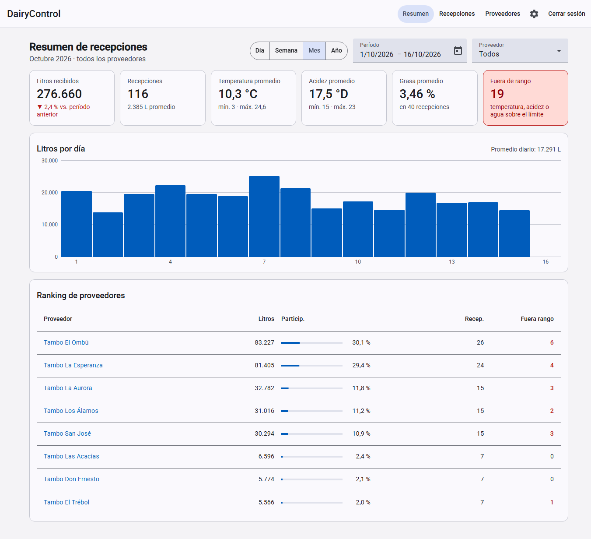
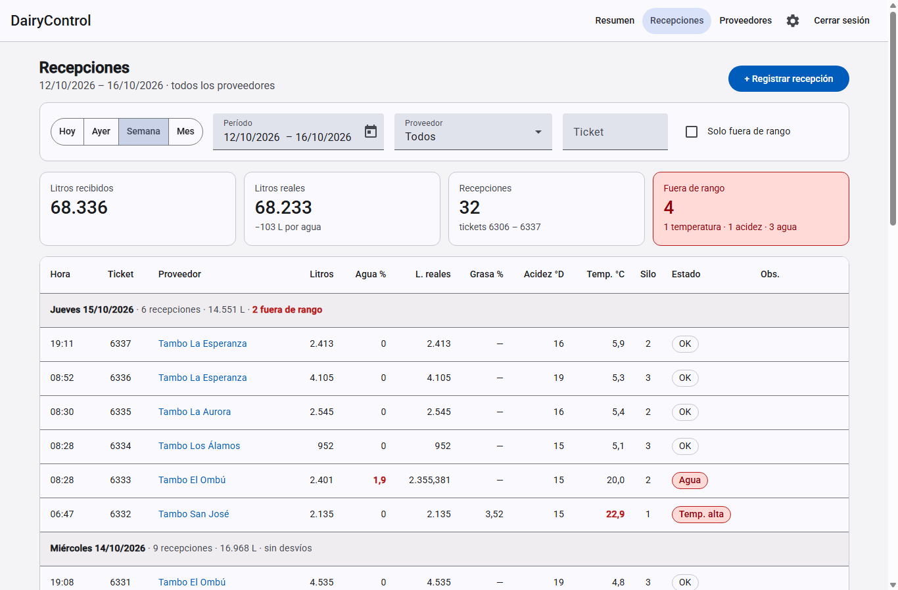
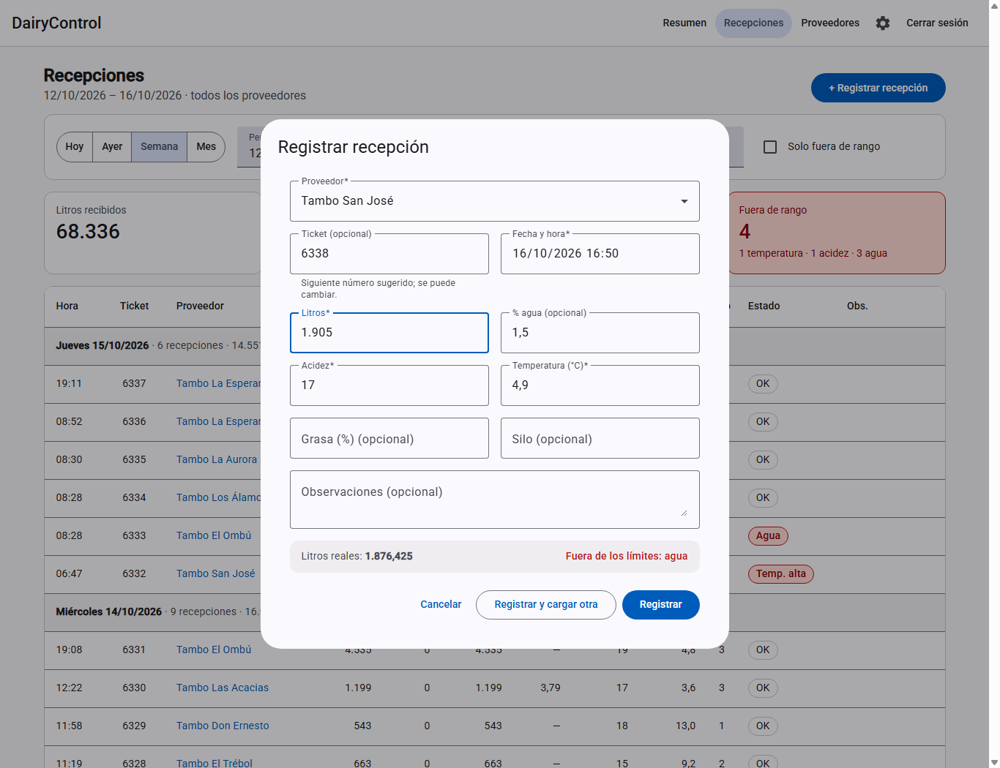
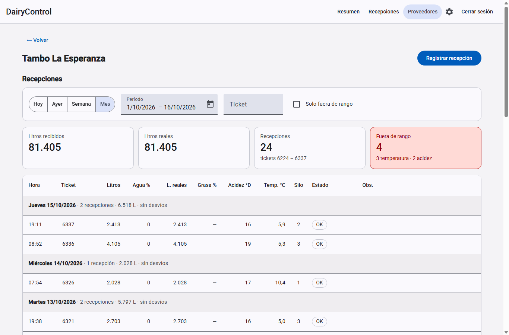
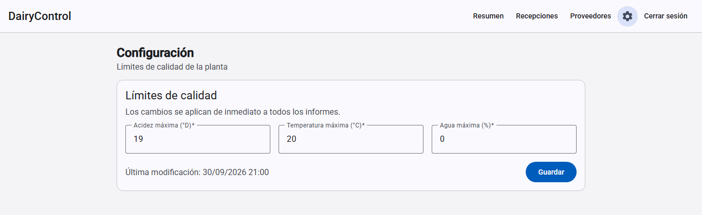
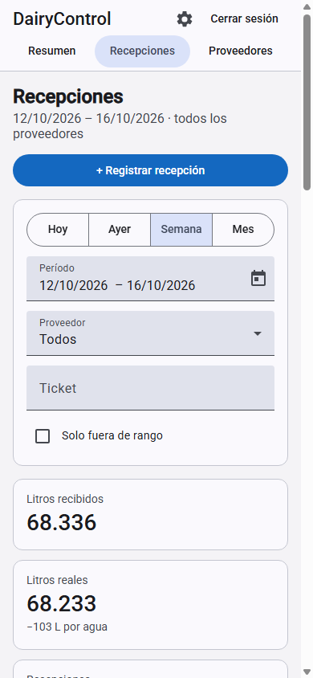
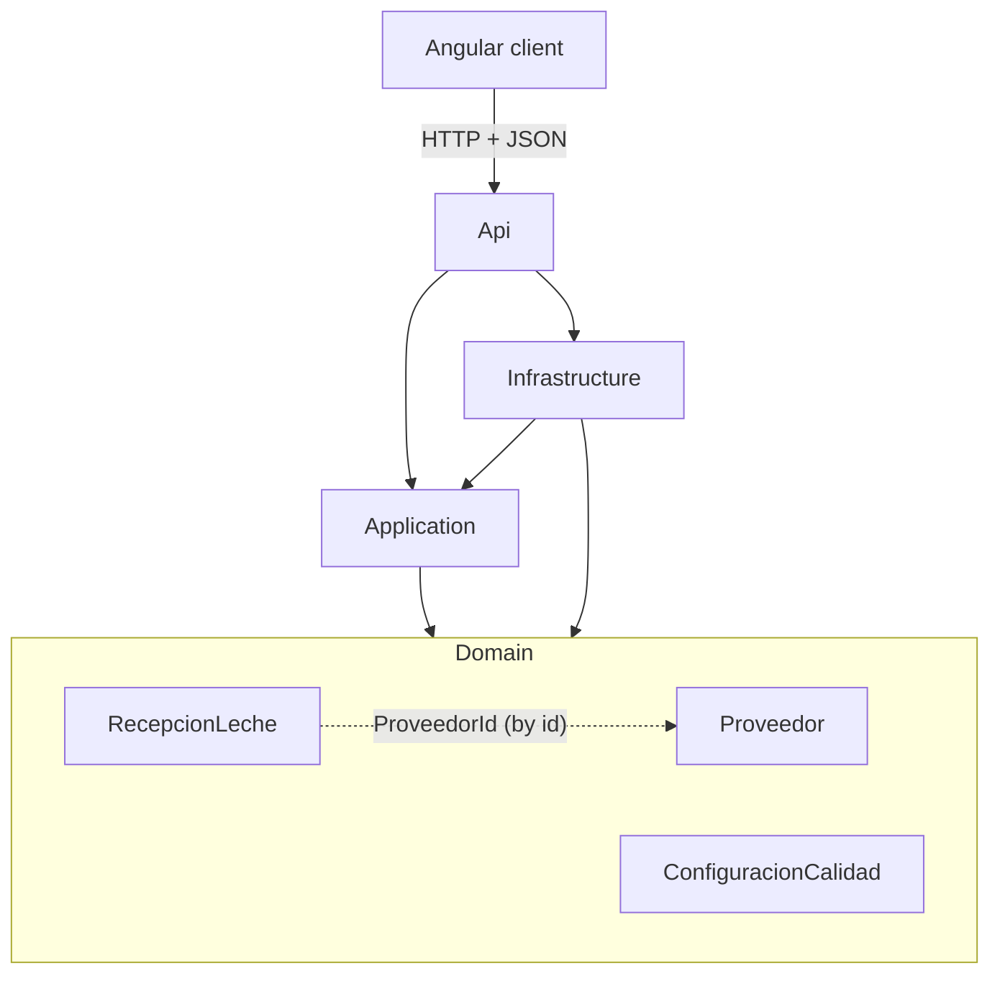

# DairyControl

Milk reception and quality control for a dairy plant, modelled on the plant's real reception spreadsheets.

[](https://github.com/isaias-muga/DairyControl/actions/workflows/ci.yml)
[](https://github.com/isaias-muga/DairyControl/actions/workflows/deploy.yml)

**.NET 10** · **Clean Architecture + DDD** · **Angular** · **SQL Server** · **Docker** · **Azure Container Apps**

## Live demo

**https://dairycontrol-client.graywave-771c6a95.brazilsouth.azurecontainerapps.io**

Log in as `admin` with the password `demodemo123`. The credentials exist only for the demo, and all data is synthetic (invented supplier names, generated values).

- The demo database is reset on every API start (a cold start, a new deploy or a restart), so anything you type is temporary.
- It scales to zero when idle, so the first request after a quiet period can take up to a minute. The app shows a "waking up" message after 3 seconds.

## Screenshots

All at 1366px with the demo data. The UI is in Spanish, like the plant.

**Resumen**: liters, quality, liters per day and supplier ranking for any period, compared with the previous one.



**Recepciones**: every delivery, grouped by day, with the reason when a value is over a limit.



**Registering a delivery**: the form previews the real liters (water deducted) and which limits the reading exceeds.



**A supplier's page** and the **quality limits**:





**On a phone (390px)**:



## What it does

A _proveedor_ is a milk supplier; a _recepción_ is one delivery received at the plant.

- **Daily reception log.** Each delivery records liters, temperature, acidity, optional fat, silo, notes, an optional plant **ticket number** and an optional **water percentage**.
- **Real liters.** Liters to pay = liters × (1 − water % / 100). The same figure is used in the form preview, the list and the totals.
- **Editable quality limits.** Maximum acidity, temperature and water are set in the app and apply immediately. A value over a limit is **accepted and flagged** (with the reason), never rejected. Defaults: 19 °D, 20 °C, 0 % water.
- **Plausible-range validation.** Typing errors are **rejected** with a clear message (for example acidity outside 10–30 °D, or more than 30,000 liters in one delivery). Plausible values are different from quality limits: a warm delivery is real and must be recorded.
- **Unique tickets.** A ticket number can be used once across the whole plant. A duplicate shows who has it and when.
- **Dashboard by period.** Day, week, month or year, or any date range, for all suppliers or one: liters against the previous period, averages, out-of-range count, liters per day, supplier ranking.
- **Recepciones list.** Daily subtotals, filters by period, supplier, ticket and "out of range only".
- **es-AR numbers and plant time.** `1.234,5` is read as 1234.5 (ambiguous input is rejected with a message). Dates are shown and validated in Buenos Aires time.
- Deliveries are records of what happened: they can be registered, not edited or deleted.

## Architecture

Clean Architecture with Domain-Driven Design. Dependencies point inward and the Domain references nothing.



| Layer              | Responsibility                                                                                                  |
| ------------------ | --------------------------------------------------------------------------------------------------------------- |
| **Domain**         | Entities, value objects, business rules, domain exceptions, repository interfaces. No packages.                 |
| **Application**    | Use cases (`ProveedorAppService`, `AuthService`, ...), DTOs, settings, read-side query interfaces.              |
| **Infrastructure** | EF Core `DbContext`, mappings, migrations, repositories, SQL queries, demo data.                                |
| **Api**            | Controllers, middleware, authentication, composition root.                                                      |

Design decisions worth knowing:

- **Small aggregates.** `Proveedor` and `RecepcionLeche` are separate aggregate roots; the delivery references its supplier by id. A collection that grows without bound never lives inside an aggregate. The third root, `ConfiguracionCalidad`, is the single row of quality limits.
- **Light CQRS.** Writes go through the domain and a repository per root. Reads (list, dashboard, supplier counts) are SQL projections behind query interfaces (`IRecepcionQueries`, `IProveedorQueries`): totals and counts are computed by the database and no delivery is loaded to count it.
- **Rules defined once, as expressions.** "Out of range" (`LimitesCalidad.FueraDeRango`) and "liters to pay" (`LitrosAPagarRegla`) are expressions in the Domain. The entity compiles them and EF Core translates the same expression to SQL, so a threshold or a formula is never copied.
- **Unique ticket enforced by the database.** The ticket spans all suppliers, so no aggregate can guard it. The service checks first to give a friendly message, and a filtered unique index is the last line of defense against two operators saving the same ticket at once.
- **Domain exceptions become HTTP errors.** A rule violation raises `ReglaDeNegocioException(message, field)` and becomes a 400 `{ error, field }`. A duplicate ticket or a stale edit becomes a 409. Anything else is a bug: it is logged with the method, path and trace id, and the client gets a 500 with that trace id.
- **Optimistic concurrency on the quality limits.** The row has a version; the PUT must send it back and answers 409 if someone saved in between.
- **Demo data through the domain.** The seeder uses the same factory methods as the API; value ranges come from aggregated reception logs and every name is invented.

At runtime only the client is public (nginx serves it and proxies `/api`); the API and the database sit behind it, in Docker Compose and on Azure. The Azure setup is in [docs/deployment.md](docs/deployment.md).

## Quality gates

- **Tests:** 260 .NET tests (Domain, Application with Moq, Api, Infrastructure on in-memory SQLite, Architecture), 454 client tests, 32 Playwright end-to-end tests.
- **Architecture tests** (`tests/DairyControl.ArchitectureTests`): the layer rules, no public setters on entities, value objects without setters, every domain exception derives from one base type, no `ArgumentException` for business rules, every controller except login has `[Authorize]`, no direct clock reads, and no entity holding a collection of another aggregate root. Breaking a rule fails the build.
- **End-to-end in CI:** Playwright runs against the full Docker Compose stack (SQL Server included) and is a required check, together with `build-test` and `client`. A pull request is required to change `main`.
- **Build:** warnings are errors, nullable is on everywhere, and an unsuppressed warning fails the build.
- **`GET /health`:** 200 when the API and the database answer, 503 otherwise. CI waits on it.
- **Deployment:** after CI passes on `main`, GitHub Actions builds both images, pushes them to GitHub Container Registry tagged with the commit and updates both Azure Container Apps. Azure login uses OIDC: no credentials are stored in the repo. Details, rollbacks and troubleshooting: [docs/deployment.md](docs/deployment.md).

## How it's built

Honest account: **the issues are implemented by Claude Code. I decide the scope, the design and the priorities, review every pull request and merge it myself.** The rules the agent works under are in [CLAUDE.md](CLAUDE.md).

Every pull request goes through:

1. A plan I approve before any code is written.
2. A self-review of the staged diff before each commit.
3. An independent review by a fresh subagent that has seen only the issue, `CLAUDE.md` and the diff.
4. Exploratory checks with Playwright on every field and endpoint the change touches (empty input, huge numbers, "3,5" vs "3.5", 5,000 characters, HTML and SQL-like text, double clicks, expired sessions).
5. Screenshots at 1366px and 390px for any UI change, and an end-to-end test for any new critical flow.

`main` is protected by a ruleset: pull request required, three required checks, no force pushes. The agent's rules forbid merging or pushing to `main`, and the ruleset requires a pull request anyway.

Numbers recorded in the notes of the 8 pull requests since the workflow was in place (#56 to #70; earlier ones predate it):

| What | Result |
| --- | --- |
| Problems found by the independent review | 33, all fixed or answered in the PR (1 to 6 per PR) |
| Bugs found by the E2E suite | 7: 1 double click, 2 date-message bugs, 3 while building the Recepciones page, 1 SQL translation failure after the aggregate split |
| Bugs found by the exploratory checks | 12 fixed in the same PR, plus 3 larger problems moved to their own issues |
| Review rounds | 1 for 7 of the 8 pull requests; 2 for the Recepciones page |
| Lead time, issue opened to PR ready | 41 minutes to about an hour where it was recorded; the rest were done the same day |

Architecture reviews are described in [docs/architecture-review.md](docs/architecture-review.md) and recorded in [docs/reviews/](docs/reviews/). One is recorded so far (2026-10-16): it was run by me and Claude, not by a fresh subagent, and it produced the architecture tests and the aggregate split below. The next one is meant to be run by a fresh subagent.

## Stories

**The double click that saved two deliveries.** Exploratory checks on the registration dialog showed that a fast double click on "Registrar" sent two requests, and a delivery without a ticket has nothing to stop the second one. The form now ignores a second submit while the first is in flight (the same for creating a supplier). An end-to-end test slows the response and double clicks; it fails on the old build and passes on the new one. The checks became a standing list in `CLAUDE.md` that runs before every PR, and later the same technique caught the same class of bug in the quality limits page before it merged.

**The ticket that could not live in an aggregate.** Tickets must be unique across all suppliers, but an aggregate boundary is one supplier, so no aggregate could guard it. The rule is enforced where it can be: a filtered unique index in the database, turned into a 409 with the owner of the ticket, plus a pre-check for a friendly message. Two parallel requests with the same ticket give exactly one 200 and one 409 on SQL Server. This is also what made the next story obvious: the one invariant that crossed suppliers was already outside the aggregate.

**A flaky test that poisoned the next ones.** One end-to-end test changes a global quality limit. When it failed, it left 25 °D stored, and the following runs read that value as their "original", so 18 of 20 repeated runs failed. The suspected cause (a save lost when navigating away) was measured and ruled out. The fix: wait for the save to finish, and restore the limit through the API in a `finally` that works even if the page is gone. Tests that change global settings now restore them that way and run with one worker.

**The aggregate that loaded the whole history.** `Proveedor` owned every delivery, so registering one loaded all of that supplier's history, and listing suppliers loaded every delivery in the database to count them. The architecture review had flagged it. `RecepcionLeche` became its own aggregate referencing the supplier by id, and counts moved to SQL. Tests with an EF command interceptor check that the list and the detail run one `COUNT` and that registering reads no other delivery. The migration kept the table and its data: on SQL Server with the demo data, row counts, sums and a checksum of every row were identical before and after, and the foreign key became `Restrict` so deliveries never disappear with a supplier. The end-to-end suite caught one query that stopped translating to SQL after the move; it got a regression test. The process change: a rule ("aggregates are small, reference others by id") and an architecture test for it.

**Keys generated by the domain.** Entities create their own `Guid` ids. EF Core's default for a key the database does not generate is to treat an entity with a key already set, discovered through a loaded parent, as an existing row: an `UPDATE` that affects zero rows. Every domain id is therefore mapped with `ValueGeneratedNever()`, a rule written in `CLAUDE.md`.

## Run it locally

Only Docker is needed for the full stack (SQL Server, API, client):

```bash
cp .env.example .env        # PowerShell: Copy-Item .env.example .env
# edit .env and set your own values
docker compose up --build
```

Open `http://localhost:8080` and log in as `admin` with the `ADMIN_PASSWORD` from `.env`. Migrations are applied and about six months of demo data (8 suppliers, ~1,400 deliveries) are seeded on the first start. `docker compose down -v` stops it and deletes the database.

```bash
dotnet test --solution DairyControl.slnx          # backend, architecture tests included
cd client && npm install && npm test              # client
cd e2e && npm ci && npx playwright install chromium && npm test   # end to end, with the stack running
```

Running without Docker (LocalDB, User Secrets, `ng serve`), the commands, the conventions and the Git workflow are in [CLAUDE.md](CLAUDE.md).

## Status

This public version is frozen as a portfolio. Development continues privately for a production pilot at a dairy plant.
