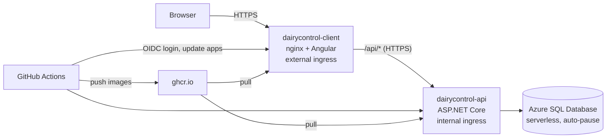

# Deployment

DairyControl runs on **Azure Container Apps** with an **Azure SQL Database** (serverless). Every merge to `main` is deployed automatically by GitHub Actions. This document describes how the environment was set up and how deployments work.

## Architecture

The shape is the same as Docker Compose: only the client is public, and nginx forwards `/api` to the API.

## Resources

All resources are in the resource group `rg-dairycontrol`, region **Brazil South**.

| Resource                   | Name                         | Notes                                                                     |
| -------------------------- | ---------------------------- | ------------------------------------------------------------------------- |
| SQL logical server         | `sql-dairycontrol-isamu`     | SQL authentication; firewall allows Azure services                        |
| SQL database               | `DairyControl`               | Free offer, serverless, auto-pause when the monthly free limit is reached |
| Container Apps environment | `cae-dairycontrol`           | Consumption plan                                                          |
| Log Analytics workspace    | `log-dairycontrol`           | Container logs, with a daily cap                                          |
| Container app              | `dairycontrol-api`           | Internal ingress, target port 8080, 0.25 CPU / 0.5 Gi, 0–1 replicas       |
| Container app              | `dairycontrol-client`        | External ingress, target port 8080, 0.25 CPU / 0.5 Gi, 0–1 replicas       |
| App registration           | `github-dairycontrol-deploy` | Identity used by the deploy workflow (OIDC)                               |

## One-time setup

### 1. Database

1. Create an **Azure SQL Database** with the **free offer** applied. Choose **"Auto-pause the database until next month"** as the behavior when the free limit is reached; this choice can't be changed later.
2. Create a new logical server with **SQL authentication**.
3. Networking: public endpoint, **"Allow Azure services and resources to access this server"** on.

The tables are not created by hand: the API applies the EF Core migrations and seeds the demo data on its first start.

### 2. Container Apps

1. Create the **API app** in a new environment:
   - Image: `ghcr.io/isaias-muga/dairycontrol-api:<tag>` (public registry, no credentials).
   - Ingress: **limited to the Container Apps environment** (internal), target port `8080`.
   - Scale: min 0, max 1.
2. Add these **secrets** to the API app:

   | Secret           | Value                                                                       |
   | ---------------- | --------------------------------------------------------------------------- |
   | `db-connection`  | ADO.NET connection string (SQL authentication) with `Connection Timeout=60` |
   | `jwt-key`        | Random signing key, at least 32 characters                                  |
   | `admin-password` | Password of the demo `admin` user                                           |

3. Set the API's **environment variables**:

   | Name                                 | Value                          |
   | ------------------------------------ | ------------------------------ |
   | `ConnectionStrings__Default`         | secret `db-connection`         |
   | `Jwt__SigningKey`                    | secret `jwt-key`               |
   | `AdminUser__Password`                | secret `admin-password`        |
   | `Database__ApplyMigrationsOnStartup` | `true`                         |
   | `DemoData__SeedOnStartup`            | `true`                         |
   | `DemoData__ResetOnStartup`           | `true`                         |
   | `HttpsRedirection__Enabled`          | `false` (Azure terminates TLS) |

   `DemoData__ResetOnStartup` wipes all proveedores and recepciones, restores the default quality limits and reseeds the demo data every time the API starts: every cold start after scaling to zero, but also every deploy of a new revision and every container restart, so someone using the demo during a deploy can lose their data. Use it only in the demo environment; the admin user is not touched.

4. Create the **client app** in the same environment:
   - Image: `ghcr.io/isaias-muga/dairycontrol-client:<tag>`.
   - Ingress: **accepting traffic from anywhere** (external), target port `8080`, insecure connections not allowed.
   - Environment variable `API_UPSTREAM` = `https://dairycontrol-api.internal.<environment default domain>`.
   - Scale: min 0, max 1.

### 3. Deploy identity (OIDC)

1. In Microsoft Entra ID, create the app registration `github-dairycontrol-deploy`.
2. Add a **federated credential** with the scenario **"Other issuer"**:
   - Issuer: `https://token.actions.githubusercontent.com`
   - Subject: `repo:isaias-muga@91924292/DairyControl@1392858313:ref:refs/heads/main`
   - Audience: `api://AzureADTokenExchange`
3. On `rg-dairycontrol`, assign the app registration the **Contributor** role. It has no rights outside this resource group.
4. In the GitHub repository, add the Actions secrets `AZURE_CLIENT_ID`, `AZURE_TENANT_ID` and `AZURE_SUBSCRIPTION_ID`. They are identifiers, not credentials.
5. In each package's settings on GitHub (**Manage Actions access**), give the `DairyControl` repository the **Write** role, so the workflow's `GITHUB_TOKEN` can push images.

### 4. Cost protection

- A **US$1 monthly budget** on the subscription, with email alerts.
- Both apps scale to zero when idle; the database pauses.
- A daily cap on the Log Analytics workspace.

With these settings, normal demo use stays inside the Azure SQL free offer and the Container Apps monthly free grant.

## How a deployment works

`.github/workflows/deploy.yml` runs when the **CI** workflow completes successfully for a push to `main`:

1. Checks out the exact commit that CI tested.
2. Builds both images and pushes them to ghcr.io, tagged with the short commit SHA.
3. Logs in to Azure with OIDC: GitHub issues a short-lived token, and Azure accepts it only for this repository's `main` branch.
4. Runs `az containerapp update --image` for the API, then for the client. Only the image changes; secrets, environment variables, ingress and scaling stay as configured.

Each update creates a new **revision**. On startup, the API applies pending migrations; the seeder does nothing when data already exists.

## Rollback

Every image is tagged with its commit SHA, so a rollback is a redeploy of an earlier tag:

- **From GitHub:** open the successful **Deploy** run of the commit to go back to, and choose **Re-run all jobs**. It redeploys that run's commit.
- **From the Azure portal:** in the app, **Containers → Edit and deploy**, change the image tag to the previous SHA and create a new revision.

A rollback does not undo database migrations. Migrations should be backward compatible with the previous version of the API.

## Troubleshooting

| Symptom                                                                                | Cause                                                                                                                                                                                                                   | Fix                                                                                                               |
| -------------------------------------------------------------------------------------- | ----------------------------------------------------------------------------------------------------------------------------------------------------------------------------------------------------------------------- | ----------------------------------------------------------------------------------------------------------------- |
| Deploy fails at Azure login with `AADSTS700213: No matching federated identity record` | The federated credential's subject doesn't match the token. GitHub sends a subject with immutable IDs (`repo:owner@id/repo@id:ref:...`), and the portal's "GitHub Actions" scenario generates the old name-only format. | Use the "Other issuer" scenario with the exact subject from the error message.                                    |
| Push to ghcr.io fails with a permission error                                          | The repository has no write access to the package.                                                                                                                                                                      | Package settings → Manage Actions access → add the repository with the Write role.                                |
| First request takes up to a minute                                                     | The apps scaled to zero and the database is paused.                                                                                                                                                                     | Expected. EF Core retries while the database resumes, and the client shows a "waking up" message after 3 seconds. |
| New API revision fails to start                                                        | Missing or wrong secret or environment variable.                                                                                                                                                                        | Check the revision's console logs (Monitoring → Log stream) and the environment variables.                        |
